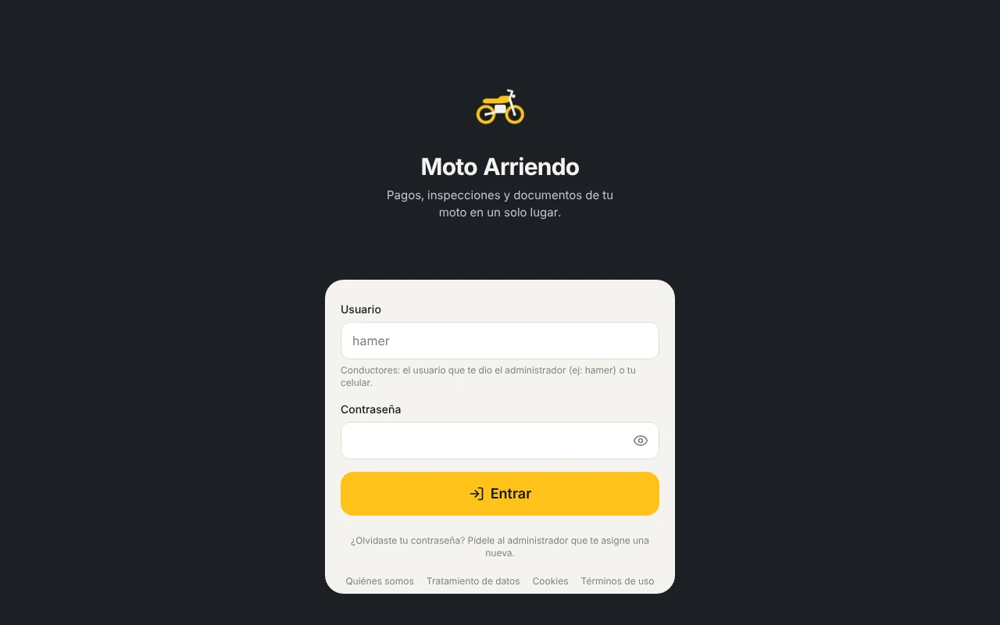
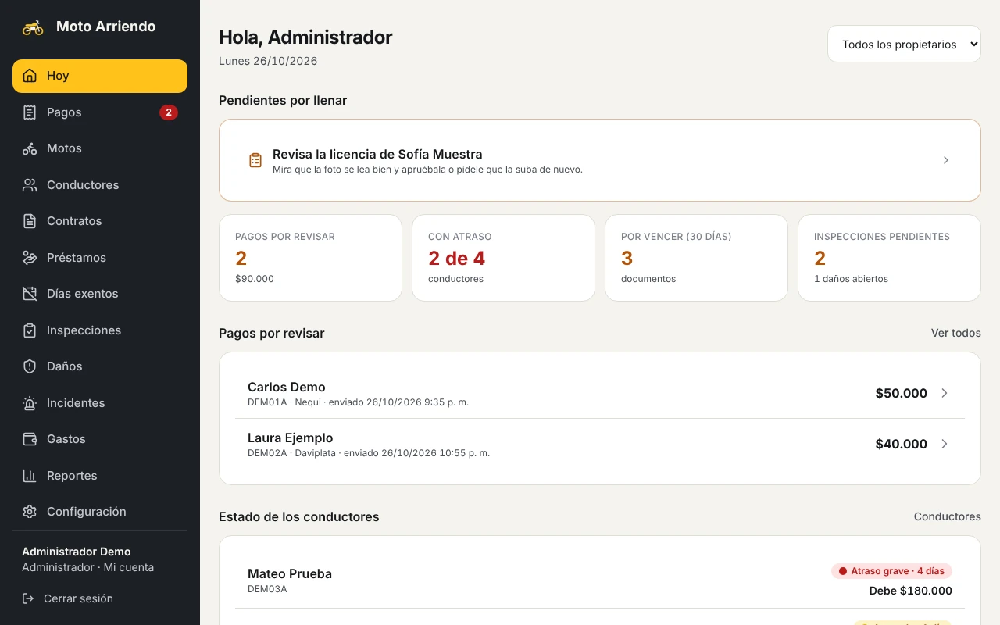
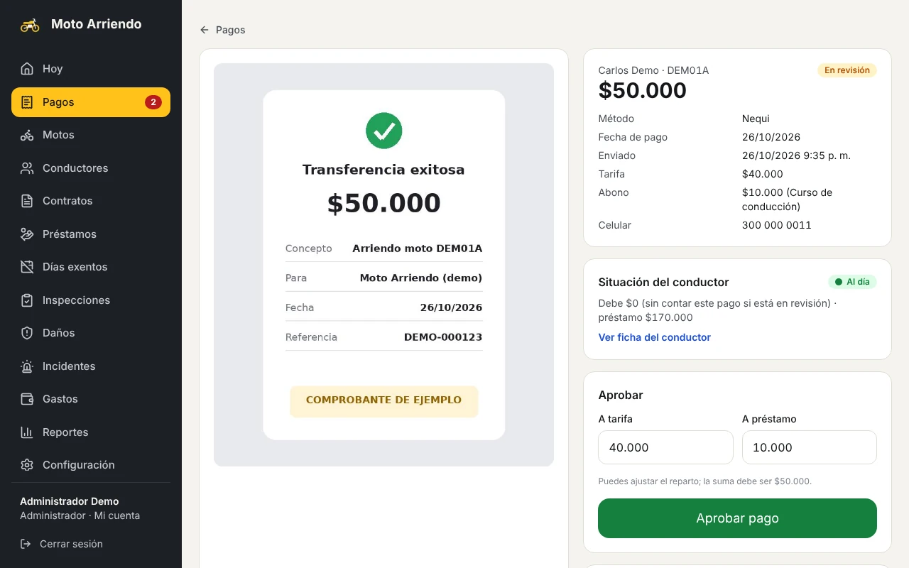
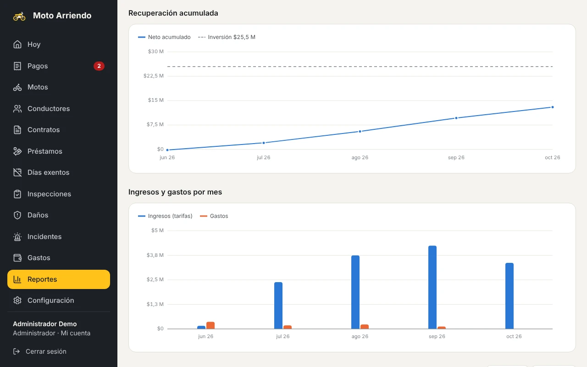
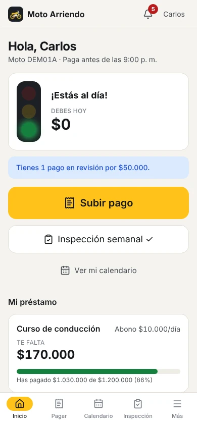
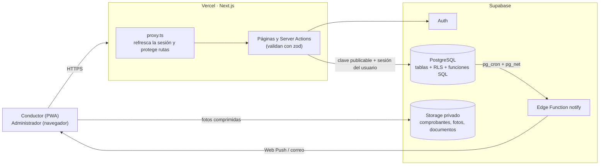

# Moto Arriendo

Aplicación web (instalable en el celular como PWA) para llevar el negocio de **arrendar motos a
conductores de aplicaciones** (Picap, DiDi, Uber Moto, Rappi). Reemplaza el cuaderno y los chats de
WhatsApp: pagos diarios con comprobante, préstamos con abonos, atrasos con semáforo, documentos con
vencimientos, inspecciones semanales, daños, incidentes y reportes de cuánto lleva recuperada cada moto.

Está pensada para dos tipos de usuario:

- **Administradores** (dueños de las motos y sus socios): entran con **correo + contraseña**, aprueban
  pagos y controlan todo desde el computador o el celular.
- **Conductores**: entran con su **usuario** (o su celular) **+ contraseña**, suben comprobantes,
  inspecciones, daños y sus documentos desde el celular.

**Demo en vivo:** https://moto-arriendo.vercel.app (solo la pantalla de entrada y las páginas legales son
públicas; las cuentas las crea un administrador).

## Capturas

| Entrada (demo en vivo) | Panel «Hoy» del administrador |
| --- | --- |
|  |  |
| **Revisar y aprobar un pago** | **Reportes: recuperación de la inversión** |
|  |  |

<p align="center">
  <br>
  <em>Inicio del conductor en el celular: semáforo, deuda del día y préstamo</em>
</p>

> La pantalla de entrada es de la demo en vivo. Las demás se tomaron con la app corriendo en local
> contra una base de datos desechable con datos **ficticios** (conductores «Carlos Demo», «Laura
> Ejemplo», placas `DEM01A`…); no hay datos de personas reales.

## Funcionalidades

**Para el administrador**

- **Panel «Hoy»:** pagos por revisar, conductores atrasados, documentos por vencer, inspecciones
  pendientes, daños abiertos, ingresos del mes por moto y por propietario, y lo que falta por llenar.
- **Pagos:** revisa el comprobante, reparte el pago entre tarifa y abono al préstamo, y lo aprueba o lo
  rechaza con un motivo. También puede registrar pagos en efectivo.
- **Conductores, motos y contratos:** tarifa diaria (con cambios por fecha), días de descanso, días exentos,
  depósito, contrato firmado y estado de cada uno.
- **Préstamos** con abono diario obligatorio u opcional y saldo al día.
- **Documentos con vencimiento:** SOAT, seguro, técnico-mecánica, licencia, cédula (por los dos lados) y
  antecedentes, con revisión y aprobación de las fotos que suben los conductores.
- **Mantenimiento por kilometraje** (configurable), con facturas y quién pagó.
- **Incidentes** (accidentes, multas, inmovilizaciones, robo) y **gastos** por moto.
- **Reportes financieros** por moto y por propietario, con gráficas de recuperación de la inversión, y
  exportación a Excel (incluido un respaldo completo).
- **Configuración:** reglas del negocio, administradores, avisos por correo, registro de auditoría y botón
  para borrar los datos de prueba.

**Para el conductor**

- Inicio con **semáforo** (🟢 al día · 🟡 1 a 2 días de atraso · 🔴 devolver la moto), lo que debe hoy y su
  préstamo.
- **Subir pago** con foto del comprobante (la app la comprime antes de subirla).
- **Inspección semanal** guiada: 5 fotos, kilometraje y lista de chequeo.
- Reporte de **daños**, **calendario** de pagos, **documentos** y **avisos**.
- Primer ingreso guiado: autorización de tratamiento de datos (Ley 1581 de 2012), sus datos, fotos de cédula
  y licencia, y su propia contraseña.

**Para todos**

- **Avisos automáticos** en la campana, por notificación push y por correo: recordatorio de pago a las 7 p. m.,
  atrasos, vencimientos a 30/15/7 días, mantenimiento e inspección.
- PWA instalable en Android e iPhone, con pantalla sin conexión.
- Páginas legales públicas (quiénes somos, tratamiento de datos, cookies y términos) y aviso de cookies.

Moneda en COP sin decimales (`$40.000`), fechas `dd/mm/aaaa` y zona horaria `America/Bogota` para todos
los cálculos de días y horas límite.

## Tecnología

| Parte | Herramienta |
| --- | --- |
| Web y servidor | Next.js 16 (App Router, Server Actions) + React 19 + TypeScript |
| Estilos e íconos | Tailwind CSS 4 + lucide-react |
| Validación | zod |
| Base de datos, usuarios y archivos | Supabase (PostgreSQL, Auth, Storage) |
| Lógica de negocio | Funciones, vistas y triggers en SQL (saldo, atraso, semáforo, reparto de pagos, finanzas) |
| Seguridad | Row Level Security (RLS) en todas las tablas y buckets privados; cabeceras CSP y HSTS |
| Avisos | Supabase Edge Function `notify` (Web Push + correo con Resend) + `pg_cron` cada 15 min |
| Excel | exceljs |
| Despliegue | Vercel (la app) + Supabase (datos y tareas programadas) |
| Celular | PWA instalable (manifest + service worker) |

## Arquitectura



- La app solo usa la **clave publicable** de Supabase. Cada consulta viaja con la sesión del usuario y
  PostgreSQL decide con **RLS** qué filas puede ver o escribir; no hay un «modo administrador» en el
  servidor que se salte esas reglas.
- Los cálculos de dinero viven en funciones SQL: una sola fuente de verdad.
- Más diagramas (inicio de sesión, pago diario, semáforo, inspección, avisos) en
  [docs/arquitectura.md](docs/arquitectura.md).

## Cómo correrlo en local

Requisitos: **Node.js 20.9 o superior** y un proyecto de **Supabase** (el plan gratuito sirve).

```bash
git clone https://github.com/ronalc90/Moto_Arriendo.git
cd Moto_Arriendo
npm ci
cp .env.example .env.local   # y llena los 2 valores de Supabase (ver abajo)
npm run dev                  # http://localhost:3000
```

Preparar la base de datos (una sola vez, en el proyecto de Supabase):

1. Ejecuta las migraciones de `supabase/migrations/` **en orden de nombre** (SQL Editor o
   `supabase db push`).
2. Crea el primer administrador desde el SQL Editor:

   ```sql
   select public.admin_create_user('admin@ejemplo.com', 'ContraseñaSegura123', 'Nombre', 'admin');
   ```

3. Opcional: carga datos de prueba con `supabase/seed/seed_test_data.sql` y bórralos después con
   `supabase/seed/clean_test_data.sql` (o desde **Configuración → Borrar datos de prueba**).
4. Opcional, para los avisos push y por correo: despliega `supabase/functions/notify` y llena la tabla
   privada `private.app_config`. Los pasos están en [docs/instalacion.md](docs/instalacion.md).

## Variables de entorno

Solo hay dos, y las dos son públicas por diseño (los datos los protege RLS):

| Variable | Ejemplo | Para qué |
| --- | --- | --- |
| `NEXT_PUBLIC_SUPABASE_URL` | `https://TU-PROYECTO.supabase.co` | URL del proyecto de Supabase |
| `NEXT_PUBLIC_SUPABASE_PUBLISHABLE_KEY` | `sb_publishable_xxxxxxxxxxxxxxxx` | Clave publicable de Supabase |

La app **no** usa la clave secreta (`service_role` / `sb_secret_`): no la pongas en `.env.local` ni en
Vercel. Las claves de los avisos (VAPID, clave del cron, Resend) se guardan en `private.app_config`,
dentro de Supabase, y no se exponen por la API.

## Scripts

| Comando | Qué hace |
| --- | --- |
| `npm run dev` | Servidor de desarrollo en http://localhost:3000 |
| `npm run build` | Compila para producción |
| `npm start` | Sirve la versión compilada |
| `npm run lint` | Revisa el código con ESLint |
| `npm run test:db` | Pruebas de saldo, RLS, avisos, finanzas y documentos contra un PostgreSQL local (`PGHOST=localhost PGUSER=postgres npm run test:db`) |
| `npm run test:rls` | Prueba de seguridad en vivo contra Supabase con los conductores de prueba |
| `npm run icons` | Regenera los íconos de la PWA desde `scripts/icon.svg` |

## Despliegue

- **App:** Vercel, con despliegue automático en cada `git push` a `main`. En el proyecto de Vercel solo
  se configuran las dos variables de entorno de arriba.
- **Datos y tareas programadas:** Supabase (migraciones, Auth, Storage, Edge Function `notify` y
  `pg_cron`). No hace falta ningún otro servicio.
- Guía completa: [instalación y despliegue](docs/instalacion.md) y
  [lista de pasos para salir a producción](docs/produccion.md).

## Documentación

- [Instalación y despliegue paso a paso](docs/instalacion.md)
- [**Salida a producción: lista de pasos**](docs/produccion.md)
- [Arquitectura y diagramas de flujo](docs/arquitectura.md)
- [Reglas de negocio (saldo, atraso, semáforo, préstamos)](docs/reglas-de-negocio.md)
- [Modelo de datos](docs/modelo-de-datos.md)
- [Manual del administrador](docs/manual-administrador.md)
- [Manual del conductor](docs/manual-conductor.md)
- [Avisos por WhatsApp: evaluación de costos](docs/whatsapp.md)
- [Diagramas de flujo (abrir en el navegador)](docs/diagramas.html)

## Fases entregadas

| Fase | Contenido |
| --- | --- |
| 0 | Proyecto, Supabase con RLS y buckets privados, login, PWA, despliegue en Vercel |
| 1 | Conductores, motos, documentos con vencimientos, contratos, pagos (subir/aprobar/rechazar), saldo, semáforo, calendario, préstamos, días exentos, inspección semanal, daños, panel Hoy, datos de prueba, pruebas de RLS |
| 2 | Mantenimiento por kilometraje (configurable) con facturas y quién pagó; avisos automáticos (campana, push y correo) |
| 3 | Incidentes (accidentes, multas, inmovilizaciones, robo), gastos, reportes financieros por moto y propietario con gráficas de recuperación de la inversión, exportar a Excel, evaluación de WhatsApp + enlaces gratis |
| Producción | Páginas legales públicas (acerca de, política de datos Ley 1581, cookies, términos), aviso de cookies, cabeceras de seguridad (CSP, HSTS), pantallas de error y de carga, respaldo completo en Excel, botón para borrar los datos de prueba |
| Puesta en marcha | Usuario para conductores, primer ingreso guiado, pendientes por llenar, tarifa por fechas, documentos del conductor por los dos lados con revisión de calidad de la foto y aprobación del administrador |

## Estructura

```
src/
  app/
    login/            inicio de sesión (usuario, celular o correo)
    consentimiento/   autorización Ley 1581 de 2012 (primer ingreso del conductor)
    bienvenida/       primer ingreso: datos, documentos y contraseña propia
    conductor/        pantallas del conductor (celular)
    admin/            pantallas del administrador
    (publico)/        páginas legales públicas
    api/exportar/     exportación a Excel
    cuenta/           cambiar contraseña
    salir/            cerrar sesión
  components/         interfaz reutilizable
  lib/                Supabase, formatos (COP, fechas Bogotá), autenticación
  proxy.ts            refresca la sesión y protege las rutas
supabase/
  migrations/         esquema, lógica de negocio, RLS, buckets, avisos, finanzas
  functions/notify/   envío de notificaciones push y correo (Edge Function)
  seed/               datos de prueba y script para borrarlos
  tests/              pruebas automáticas de saldo, RLS, avisos y finanzas
docs/                 manuales, arquitectura, reglas de negocio y capturas
```

## Seguridad en una línea

La app solo usa la clave **publicable** de Supabase. Toda la protección vive en la base de datos (RLS),
así que un conductor no puede ver nada de otro aunque manipule la app. La clave secreta
(`service_role`) **no se usa en la app**. Las cabeceras HTTP incluyen una política de contenido (CSP) que
solo permite cargar recursos de la propia app y de Supabase.
