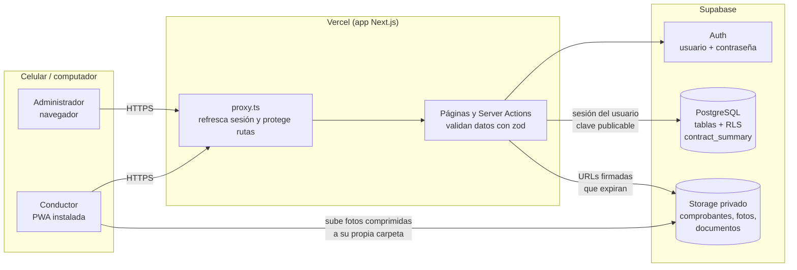
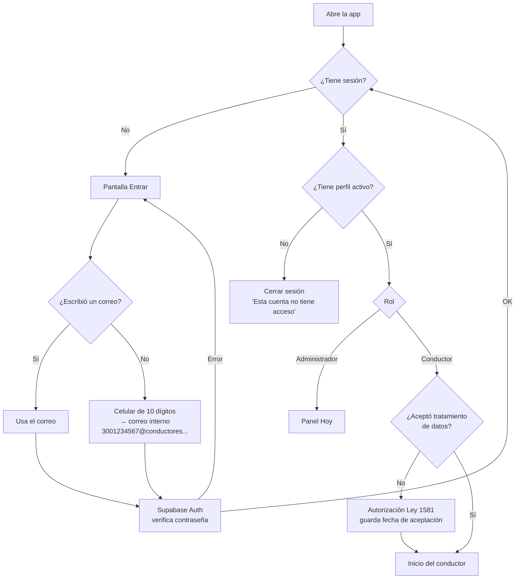
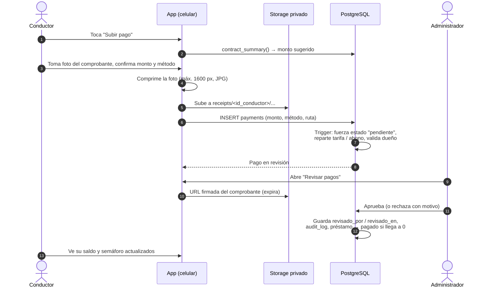
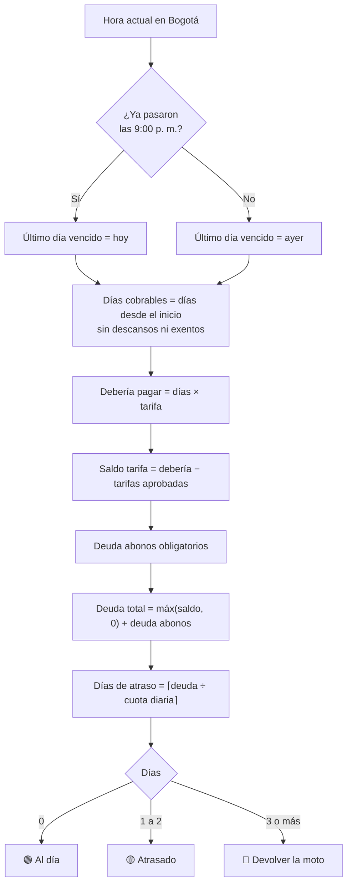
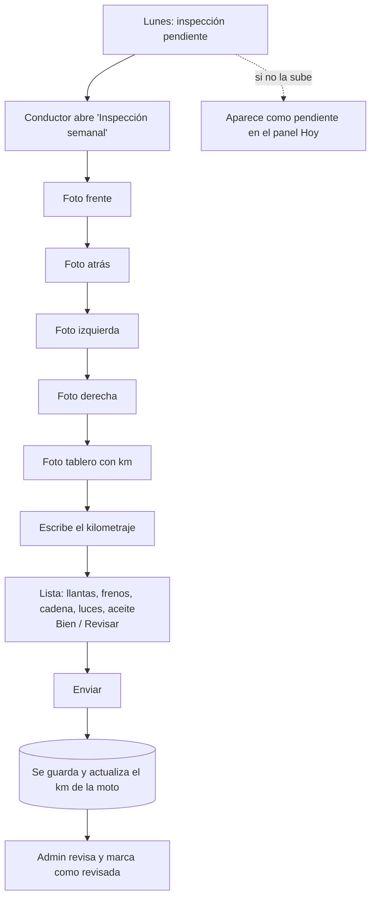
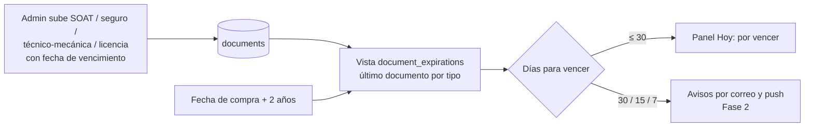
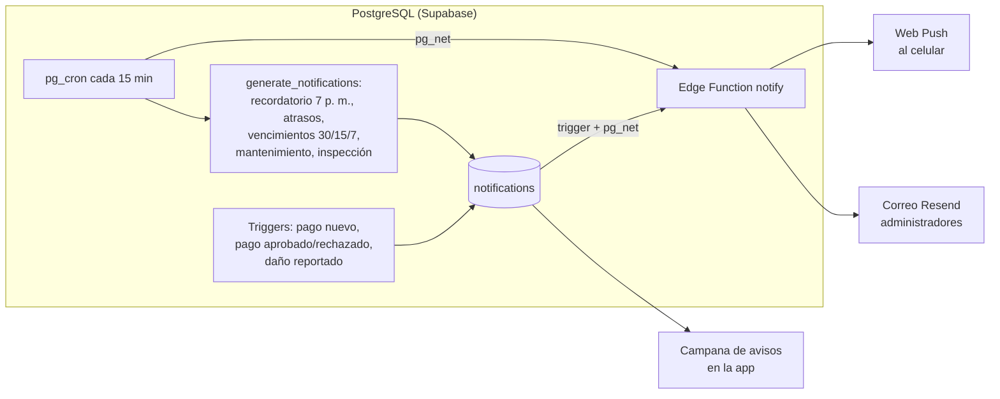

# Arquitectura y diagramas de flujo

> Los diagramas están en formato Mermaid: GitHub los dibuja automáticamente al abrir este archivo.

## 1. Vista general

- La app solo usa la **clave publicable**. Cada consulta viaja con la sesión del usuario, y PostgreSQL
  decide con **RLS** qué filas puede ver o escribir. No existe un "modo administrador" en el servidor
  que se salte esas reglas.
- Los cálculos de dinero (saldo, atraso, reparto de pagos) viven en funciones SQL: una sola fuente de
  verdad.

## 2. Inicio de sesión

Solo un administrador crea cuentas (función `admin_create_user`). Aunque alguien lograra registrarse
por su cuenta, sin fila en `profiles` no ve absolutamente nada.

## 3. Pago diario (de punta a punta)

## 4. Cálculo del semáforo

## 5. Inspección semanal

## 6. Documentos y vencimientos

## 7. Avisos automáticos

Cada aviso tiene una clave única (por ejemplo `exp:soat:<moto>:<fecha>:15`), así nunca se repite.

## 8. Seguridad (quién ve qué)

| Información | Administrador | Conductor |
| --- | --- | --- |
| Perfiles | Todos | Solo el suyo |
| Motos | Todas | Solo la de su contrato vigente |
| Contratos, pagos, préstamos, días exentos | Todos | Solo los suyos |
| Documentos | Todos | Los suyos y los de su moto |
| Inspecciones y daños | Todos (revisa y cierra) | Crea y ve los suyos |
| Archivos (Storage) | Todos | Solo su carpeta y documentos de su moto |
| Registro de auditoría | Lee | Nada |
| Aprobar pagos, crear cuentas | Sí | No |

La prueba automática `supabase/tests/rls_and_balance_test.sql` verifica estas reglas.
