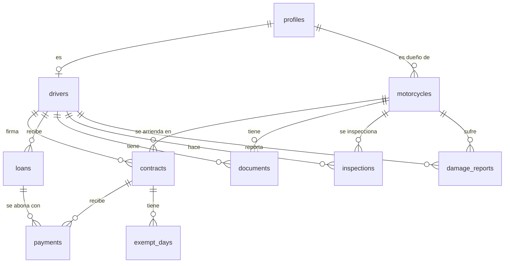

# Modelo de datos

Los nombres de tablas y columnas están en inglés (el código va en inglés); la interfaz está en español.
Esta tabla relaciona tu propuesta original con lo implementado.

| Propuesta | Tabla | Cambios y por qué |
| --- | --- | --- |
| profiles | `profiles` | + `email`, `active` (desactivar sin borrar historial). `acepto_datos_en` = `data_consent_at` |
| conductores | `drivers` | Igual. `licencia_vence` = `license_expires_on` alimenta las alertas |
| motos | `motorcycles` | Igual. `km_actual` se actualiza solo con cada inspección |
| documentos | `documents` | En vez de `entidad_id` genérico hay dos columnas (`motorcycle_id`, `driver_id`) con una regla que exige exactamente una. Así la base de datos garantiza que el documento apunte a algo que existe, y las reglas de seguridad son más simples |
| contratos | `contracts` | `dias_descanso` es una lista de días (0 = domingo … 6 = sábado). Un conductor y una moto solo pueden tener **un** contrato vigente a la vez |
| prestamos | `loans` | + `installment_required` (abono obligatorio, por defecto sí) y `loan_date` (desde cuándo cuenta el abono) |
| pagos | `payments` | Igual + `notes`, `created_by`. Regla: tarifa + abono = total. El reparto lo hace la base de datos |
| dias_exentos | `exempt_days` | Igual; no se puede repetir el mismo día en un contrato |
| inspecciones | `inspections` | Las 5 fotos son columnas separadas (obligatorias); la lista de chequeo es JSON `{tires, brakes, chain, lights, oil}` con `ok` / `check` |
| reportes_dano | `damage_reports` | + `resolution_notes`, `closed_by`, `closed_at` |
| — | `settings` | **Nueva.** Día de la inspección semanal, días de aviso (30/15/7), tarifa y abono por defecto. Fase 2 agrega intervalos de mantenimiento |
| — | `audit_log` | **Nueva.** Quién cambió qué y cuándo (aprobaciones, rechazos, cambios de contrato…). Solo la escriben los triggers |

## Vistas y funciones

| Nombre | Para qué |
| --- | --- |
| `contract_summary(contrato)` | Saldo, deuda, días de atraso, semáforo, monto sugerido |
| `contract_calendar(contrato, desde, hasta)` | Estado de cada día (pagado, vencido, descanso, exento…) |
| `allocate_payment(contrato, monto)` | Reparto tarifa → abono → adelanto |
| `contract_overview` (vista) | Todos los contratos con su resumen (panel del admin) |
| `loan_balances` (vista) | Préstamos con lo abonado y el saldo |
| `document_expirations` (vista) | Próximos vencimientos |
| `inspection_status` (vista) | Inspección de la semana hecha / pendiente |
| `admin_create_user`, `admin_set_password` | Crear cuentas y asignar contraseñas (solo administradores) |
| `accept_data_policy()` | Guarda la aceptación de la Ley 1581 |

## Diagrama entidad-relación

## Archivos (Storage, todos privados)

| Bucket | Ruta | Tipos | Máximo |
| --- | --- | --- | --- |
| `receipts` | `<id_conductor>/...` | JPG, PNG, WEBP, PDF | 6 MB |
| `inspections` | `<id_conductor>/...` | JPG, PNG, WEBP | 6 MB |
| `damages` | `<id_conductor>/...` | JPG, PNG, WEBP | 6 MB |
| `documents` | `<id_conductor>/...` o `moto/<id_moto>/...` | JPG, PNG, WEBP, PDF | 10 MB |
| `contracts` | `<id_conductor>/...` | PDF, JPG, PNG | 10 MB |

Supabase rechaza en el servidor cualquier archivo de otro tipo o más grande. Las fotos se comprimen en
el celular antes de subir (máximo 1600 px, JPG).
